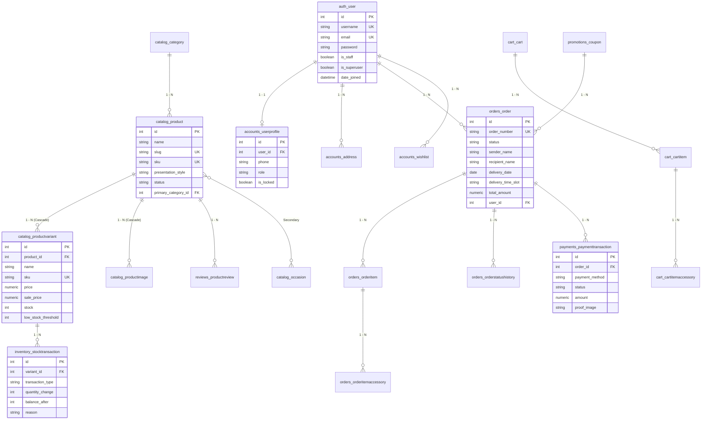

# BÁO CÁO ĐỒ ÁN MÔN HỌC
## LẬP TRÌNH PYTHON NÂNG CAO
### Đề tài: Website bán hoa trực tuyến (Flora Flower Boutique)

---

## THÔNG TIN CHUNG

* **Cơ sở đào tạo:** TRƯỜNG ĐẠI HỌC VĂN LANG
* **Khoa:** KHOA CÔNG NGHỆ THÔNG TIN
* **Môn học:** Lập trình Python Nâng cao
* **Mã học phần:** `71ITSE31003` – **Nhóm lớp:** `253_71ITSE31003_01`
* **Giảng viên hướng dẫn:** ThS. Nguyễn Thị Mỹ Linh
* **Nhóm sinh viên thực hiện:** [Cần bổ sung: Nhóm ...]

| STT | Mã số sinh viên (MSSV) | Họ và tên sinh viên | Nhiệm vụ chính phụ trách | Tỷ lệ đóng góp |
| :---: | :---: | :---: | :--- | :---: |
| 1 | [Cần bổ sung] | [Cần bổ sung] | Kiến trúc ứng dụng Flask, Models CSDL SQLAlchemy, Tầng Dịch vụ Email | [Cần bổ sung] |
| 2 | [Cần bổ sung] | [Cần bổ sung] | Routes, Blueprints, Form Validation (Flask-WTF), Logic Giỏ hàng & Đơn hàng | [Cần bổ sung] |
| 3 | [Cần bổ sung] | [Cần bổ sung] | Giao diện Jinja2 (Storefront & Dashboard), REST API (CLO3), Bộ kiểm thử tự động | [Cần bổ sung] |

* **Email nhận thông báo đơn hàng của Chủ shop:** `phuongtruong121204@gmail.com`
* **Thời gian thực hiện:** Học kỳ 2 – Năm học 2025–2026

---

## 1. GIỚI THIỆU ĐỀ TÀI

### 1.1. Mô tả bài toán
Trong thời đại kinh tế số, nhu cầu đặt mua hoa tươi trực tuyến để gửi gắm tình cảm vào các dịp đặc biệt (sinh nhật, khai trương, kỷ niệm, lễ cưới, chia buồn...) ngày càng tăng cao. Tuy nhiên, ngành hoa tươi sở hữu những đặc thù nghiệp vụ phức tạp mà các website thương mại điện tử tổng hợp thông thường không đáp ứng trọn vẹn:
1. **Phân biệt rành mạch Người Đặt (Sender) và Người Nhận (Recipient):** Người thanh toán đơn hoa thường gửi tặng người khác; cần quản lý địa chỉ nhận riêng, lời nhắn in thiệp và tùy chọn **Gửi ẩn danh** (giấu danh tính người tặng).
2. **Khung giờ giao hoa nghiêm ngặt (Delivery Date & Time Slot):** Hoa tươi không thể lưu kho lâu sau khi cắm; hệ thống bắt buộc khách chọn ngày giao cụ thể và khung giờ cắm hoa/giao hoa (08:00–10:00, 10:00–12:00, 13:00–15:00, 15:00–17:00, 17:00–19:00, 19:00–21:00) kèm quy tắc chặn đơn sau giờ cắt (Cutoff hour: 18:00).
3. **Mô hình biến thể kích thước hoa (Size S / M / L):** Mỗi thiết kế hoa có phiên bản Tiêu chuẩn (Size S), Vừa vặn (Size M), Đặc biệt (Size L) tương ứng với số lượng cành hoa, kích thước bình/giỏ, giá tiền và số lượng tồn kho riêng.
4. **Bán kèm phụ kiện hoa tươi:** Cho phép chọn thêm thiệp ép kim, banner in chữ khai trương, gấu bông tốt nghiệp, đèn LED trang trí.
5. **Thanh toán chuyển khoản VietQR & Đối soát biên lai:** Tạo mã QR ngân hàng động theo chuẩn NAPAS có sẵn số tiền và mã đơn hàng; khách hàng tải ảnh chứng từ để nhân viên kiểm tra duyệt tiền trước khi florist cắm hoa.

Đề tài **Flora Flower Boutique** được xây dựng nhằm giải quyết toàn diện các bài toán thực tế trên bằng ngôn ngữ **Python** và framework **Flask**.

### 1.2. Đối tượng sử dụng
Hệ thống phục vụ 4 nhóm người dùng thông qua cơ chế phân quyền (Role-Based Access Control):
* **Khách vãng lai (Guest):** Xem danh mục hoa, tra cứu sản phẩm, tìm kiếm, đọc hướng dẫn chăm sóc hoa, tra cứu đơn hàng bằng số điện thoại/mã đơn.
* **Khách hàng đã đăng ký (Customer):** Quản lý giỏ hàng, đặt hàng theo khung giờ, lưu sổ địa chỉ nhận hoa, xem lịch sử đơn, tải biên lai chuyển khoản VietQR, viết đánh giá sản phẩm sau khi đơn hoàn tất.
* **Nhân viên xử lý & Florist (Staff):** Truy cập Cổng Quản Trị Nghiệp Vụ (`/dashboard/`), xem lịch giao hoa theo ngày/khung giờ, in phiếu cắm hoa (`Florist Sheet`), in hóa đơn (`Customer Bill`), cập nhật trạng thái đơn (Đang cắm hoa, Sẵn sàng giao, Đang giao).
* **Quản trị viên (Admin):** Toàn quyền cấu hình cửa hàng, CRUD sản phẩm và biến thể, kiểm kê và nhập kho hoa, duyệt đối soát thanh toán, quản lý tài khoản khách hàng (khóa/mở khóa), quản lý mã giảm giá, kiểm duyệt đánh giá, xem biểu đồ doanh thu và nhật ký hoạt động (`AuditLog`).

### 1.3. Mục tiêu và phạm vi đề tài
* **Mục tiêu học thuật:** Đáp ứng đầy đủ các chuẩn đầu ra (CLO) theo đề cương môn học:
  * **CLO2 (50%):** Xây dựng ứng dụng Flask hoàn chỉnh: Application Factory, Blueprints, Jinja2 template inheritance, Form validation (Flask-WTF), Database ORM (Flask-SQLAlchemy) và Email giao dịch (Flask-Mail).
  * **CLO3 (10%):** Lập trình mạng với REST API trả về JSON chuẩn hóa (`/api/v1/...`) và script client tự động gọi HTTP bằng thư viện `requests`/`urllib`.
  * **CLO4 (20%):** Vận dụng thành thạo hệ sinh thái thư viện Python: Flask, Flask-WTF, WTForms, Flask-SQLAlchemy, Flask-Login, Flask-Mail, python-dotenv, Pillow.
  * **CLO5 (10%):** Tổ chức mã nguồn theo mô hình kiến trúc lớn (Large Application Structure), code module hóa rõ ràng, dễ bảo trì.
  * **CLO6 (10%):** Kèm theo bộ kiểm thử tự động 23 test cases (`run_tests.py`), kịch bản demo minh chứng và tài liệu hướng dẫn triển khai.
* **Phạm vi hệ thống:** Tập trung vào chu trình khép kín của cửa hàng hoa tươi: Chọn hoa -> Tùy biến phụ kiện -> Đặt lịch giao -> Thanh toán VietQR/COD -> Thông báo Email -> Duyệt đối soát -> Cắm hoa & Giao nhận -> Đánh giá phản hồi.

### 1.4. Công nghệ và thư viện thực tế sử dụng

| Công nghệ / Thư viện | Phiên bản | Mục đích sử dụng trong dự án |
| :--- | :---: | :--- |
| **Python** | 3.12+ / 3.14+ | Ngôn ngữ lập trình chính của toàn bộ hệ thống |
| **Flask** | 3.1.x | Web framework nền tảng, tổ chức theo Large Application Structure |
| **Flask-SQLAlchemy** | 3.1.x | ORM quản lý mô hình dữ liệu quan hệ, quan hệ 1-N, N-N, lazy loading |
| **Flask-WTF & WTForms**| 1.2.x / 3.2.x | Xây dựng form đăng nhập, đăng ký, checkout, CRUD và chống tấn công CSRF |
| **Flask-Login** | 0.6.x | Quản lý phiên đăng nhập người dùng (session), current_user, login_required |
| **Flask-Mail** | 0.9.x | Tích hợp giao thức SMTP gửi email giao dịch HTML tự động |
| **Jinja2** | 3.1.x | Template engine: kế thừa layout, macro, custom filters, context processor |
| **python-dotenv** | 1.0.x | Nạp biến môi trường tự động từ file `.env` vào cấu hình Flask |
| **requests** | 2.32.x | Lập trình mạng CLO3: gửi HTTP GET/POST kiểm thử REST API |
| **Pillow (PIL)** | 11.x | Xử lý ảnh hoa tươi, thumbnail và ảnh biên lai chuyển khoản |
| **SQLite (`db.sqlite3`)** | 3.x | Hệ quản trị CSDL quan hệ gọn nhẹ, thuận tiện nộp bài và chấm thi |
| **Bootstrap 5.3 & Icons** | 5.3.3 | Thiết kế giao diện hiện đại phong cách Boutique Pháp, responsive di động |

---

## 2. PHÂN TÍCH VÀ THIẾT KẾ HỆ THỐNG

### 2.1. Phân loại chức năng hệ thống

```
                                  HỆ THỐNG FLORA FLOWER
                                           │
         ┌─────────────────────────────────┴─────────────────────────────────┐
         ▼                                                                   ▼
   CHỨC NĂNG BẮT BUỘC (Rubric)                                     CHỨC NĂNG MỞ RỘNG (Nghiệp vụ hoa)
   ├── 1. Xác thực & Phân quyền (Flask-Login)                      ├── 1. Biến thể hoa kích thước S / M / L
   ├── 2. CRUD Sản phẩm & Danh mục (Flask-WTF)                     ├── 2. Lịch chọn ngày & 6 khung giờ giao hoa
   ├── 3. Tìm kiếm từ khóa & Phân trang 15 mục                     ├── 3. Phụ kiện bán kèm (Banner, thiệp, đèn)
   ├── 4. Cơ sở dữ liệu quan hệ (Flask-SQLAlchemy)                 ├── 4. Thanh toán VietQR động theo chuẩn NAPAS
   ├── 5. Dịch vụ gửi Email tự động (Flask-Mail)                   ├── 5. Upload & Duyệt ảnh biên lai ngân hàng
   └── 6. Lập trình mạng & REST API JSON (CLO3)                    ├── 6. Sổ cái biến động kho hoa (Idempotent)
                                                                   ├── 7. Quản lý mã ưu đãi giảm giá (Coupon)
                                                                   ├── 8. In phiếu cắm hoa & In hóa đơn giao hàng
                                                                   └── 9. Báo cáo thống kê & Xuất dữ liệu CSV
```

#### Phân quyền người dùng chi tiết:
1. **Khách vãng lai:** Xem trang chủ, xem danh mục, lọc theo dịp tặng, xem chi tiết mẫu hoa và các biến thể kích thước, tra cứu đơn hàng không cần đăng nhập.
2. **Khách hàng (Customer):** Thêm hoa vào giỏ, nhập mã coupon, điền thông tin người đặt & người nhận, chọn lịch giao, thanh toán VietQR, tải ảnh bill, theo dõi trạng thái đơn, quản lý sổ địa chỉ, đánh giá hoa.
3. **Nhân viên (Staff):** Truy cập `/dashboard/`, xem danh sách đơn hàng, xem lịch giao hoa theo ngày, in phiếu cắm hoa cho thợ, in hóa đơn giao hàng, cập nhật trạng thái đơn (*Đang cắm hoa*, *Sẵn sàng giao*, *Đang giao*).
4. **Quản trị viên (Admin):** Toàn quyền truy cập mọi chức năng trên dashboard, thêm/sửa/xóa hoa tươi (Safe Soft-Delete), điều chỉnh và nhập kho hoa, duyệt đối soát thanh toán VietQR, khóa/mở khóa tài khoản khách hàng, tạo mã voucher, cấu hình tài khoản ngân hàng và phí ship, xem nhật ký kiểm toán `AuditLog`, xuất báo cáo đơn hàng ra file CSV.

### 2.2. Thiết kế cơ sở dữ liệu (Database Schema)

Cơ sở dữ liệu gồm **14 bảng quan hệ chính** được quản lý chặt chẽ bằng SQLAlchemy ORM:



#### Mô tả các model SQLAlchemy cốt lõi:

| Tên Model / Bảng | Khóa chính (PK) | Khóa ngoại (FK) | Cột chính | Quan hệ nghiệp vụ |
| :--- | :--- | :--- | :--- | :--- |
| **User** (`auth_user`) | `id` (int) | Không | `username`, `email`, `password`, `is_staff`, `is_superuser` | 1-1 với `UserProfile`, 1-N với `Order`, `Address` |
| **UserProfile** (`accounts_userprofile`) | `id` (int) | `user_id` | `phone`, `role` (ADMIN/CUSTOMER), `is_locked` | Chứa vai trò và trạng thái khóa tài khoản |
| **Address** (`accounts_address`) | `id` (int) | `user_id` | `full_name`, `phone`, `street_address`, `ward`, `district` | Sổ địa chỉ giao hoa của khách hàng |
| **Category** (`catalog_category`) | `id` (int) | Không | `name`, `slug`, `image`, `display_order` | Danh mục kiểu cắm (Bó hoa, Giỏ hoa, Kệ hoa...) |
| **Occasion** (`catalog_occasion`) | `id` (int) | Không | `name`, `slug`, `icon`, `display_order` | Dịp tặng hoa (Sinh nhật, Khai trương, Lễ cưới...) |
| **Product** (`catalog_product`) | `id` (int) | `primary_category_id` | `name`, `slug`, `sku`, `status`, `main_image` | Mẫu hoa gốc, hỗ trợ Soft-Delete qua trường `status` |
| **ProductVariant** (`catalog_productvariant`) | `id` (int) | `product_id` | `name` (Size S/M/L), `sku`, `price`, `sale_price`, `stock` | Biến thể kích thước quản lý giá bán và tồn kho riêng |
| **Order** (`orders_order`) | `id` (int) | `user_id`, `coupon_id` | `order_number`, `status`, `sender_name`, `recipient_name`, `delivery_date`, `delivery_time_slot`, `total_amount` | Đơn hàng lưu thông tin người tặng, người nhận, lời nhắn thiệp |
| **OrderItem** (`orders_orderitem`) | `id` (int) | `order_id`, `product_variant_id`| `product_name`, `variant_name`, `unit_price`, `quantity`, `subtotal` | Chi tiết các mẫu hoa được đặt trong đơn |
| **PaymentTransaction** (`payments_paymenttransaction`) | `id` (int) | `order_id` | `payment_method`, `status` (PENDING/PAID/FAILED), `amount`, `proof_image` | Giao dịch thanh toán VietQR / COD, ảnh biên lai đối soát |
| **StockTransaction** (`inventory_stocktransaction`) | `id` (int) | `variant_id`, `reference_order_id`| `transaction_type` (IMPORT/SALE/CANCEL_RESTORE), `quantity_change`, `balance_after`, `reason` | Sổ cái kho hoa ghi vết lịch sử trừ kho khi bán và hoàn kho khi hủy đơn |
| **Coupon** (`promotions_coupon`) | `id` (int) | Không | `code`, `discount_type`, `discount_value`, `min_order_amount`, `valid_to` | Mã giảm giá ưu đãi mua hoa |
| **ContactMessage** (`content_contactmessage`) | `id` (int) | `assigned_to_id` | `full_name`, `email`, `phone`, `subject`, `message`, `status` | Tin nhắn yêu cầu tư vấn khách gửi qua website |
| **ShopSetting** (`core_shopsetting`) | `id` (int) | Không | `shop_name`, `hotline`, `bank_code`, `bank_account_no`, `same_day_cutoff_hour` | Cấu hình cửa hàng, tài khoản VietQR và phí giao hoa |

### 2.3. Thiết kế luồng màn hình & Kế thừa Template Jinja2

Toàn bộ giao diện được tổ chức theo cấu trúc phân tầng với Jinja2, bảo đảm DRY (Don't Repeat Yourself):
* [`templates/base.html`](file:///d:/shophoa-python/templates/base.html): Layout khung chính của Storefront, nạp Bootstrap 5, navbar menu, modal tìm kiếm, giỏ hàng popup và toast notification.
  * [`templates/header.html`](file:///d:/shophoa-python/templates/header.html): Thanh điều hướng danh mục, ô tìm kiếm và biểu tượng giỏ hàng.
  * [`templates/footer.html`](file:///d:/shophoa-python/templates/footer.html): Thông tin chân trang, chính sách và liên hệ cửa hàng.
  * [`templates/shop/index.html`](file:///d:/shophoa-python/templates/shop/index.html): Trang chủ (Hero Banner slider, dịp tặng, kiểu cắm, hoa bán chạy, hoa signature).
  * [`templates/shop/product_list.html`](file:///d:/shophoa-python/templates/shop/product_list.html): Danh sách hoa có bộ lọc giá, sắp xếp, tìm kiếm và thanh phân trang.
  * [`templates/shop/product_detail.html`](file:///d:/shophoa-python/templates/shop/product_detail.html): Chi tiết mẫu hoa, chọn biến thể kích thước S/M/L, chọn phụ kiện mua kèm, viết đánh giá.
  * [`templates/shop/cart.html`](file:///d:/shophoa-python/templates/shop/cart.html) & [`checkout.html`](file:///d:/shophoa-python/templates/shop/checkout.html): Giỏ hàng và màn hình thanh toán đặt lịch giao hoa.
* [`templates/dashboard/base.html`](file:///d:/shophoa-python/templates/dashboard/base.html): Layout khung riêng của Cổng Quản Trị Nghiệp Vụ, thanh menu dọc (Sidebar) phân nhóm chức năng và thanh tiêu đề Topbar.
  * `dashboard/index.html`: Bảng số liệu tổng quan & biểu đồ doanh thu.
  * `dashboard/products/list.html` & `form.html`: Quản lý hoa tươi & thư viện ảnh.
  * `dashboard/orders/list.html`, `detail.html`, `calendar.html`: Xử lý đơn, đổi trạng thái và lịch giao hoa.
  * `dashboard/inventory/list.html`: Kiểm kê và theo dõi sổ cái biến động kho.
  * `dashboard/payments/list.html`: Đối soát biên lai chuyển khoản VietQR.
  * `dashboard/customers/list.html` & `detail.html`: Danh sách khách hàng và lịch sử chi tiêu.
  * `dashboard/promotions/list.html`: Danh sách mã giảm giá.
  * `dashboard/content/contacts.html`: Quản lý tin nhắn liên hệ.

---

## 3. XÂY DỰNG ỨNG DỤNG VỚI FLASK

### 3.1. Cấu trúc ứng dụng Flask (Large Application Structure)
Ứng dụng được thiết kế theo mô hình chuẩn của tài liệu Flask chuyên sâu:
* Điểm khởi chạy `run.py` kích hoạt Application Factory.
* File cấu hình [`config.py`](file:///d:/shophoa-python/config.py) phân tách 3 môi trường: `DevelopmentConfig`, `TestingConfig`, `ProductionConfig`.
* Toàn bộ logic được gói gọn trong thư mục `app/`, chia tách rành mạch thành: `blueprints/`, `models/`, `forms/`, `services/`.

```python
# Trích đoạn app/__init__.py: Application Factory
def create_app(config_name=None):
    if config_name is None:
        config_name = os.environ.get('FLASK_CONFIG', 'development')

    app = Flask(__name__, template_folder=str(BASE_DIR / 'templates'), static_folder=str(BASE_DIR / 'static'))
    app.config.from_object(config_by_name[config_name])

    # Khởi tạo các tiện ích mở rộng
    db.init_app(app)
    migrate.init_app(app, db)
    login_manager.init_app(app)
    mail.init_app(app)
    csrf.init_app(app)

    # Đăng ký 8 Blueprints nghiệp vụ
    from app.blueprints.main import bp as main_bp
    from app.blueprints.catalog import bp as catalog_bp
    from app.blueprints.cart import bp as cart_bp
    from app.blueprints.orders import bp as orders_bp
    from app.blueprints.auth import bp as auth_bp
    from app.blueprints.reviews import bp as reviews_bp
    from app.blueprints.dashboard import bp as dashboard_bp
    from app.blueprints.api import bp as api_bp

    app.register_blueprint(main_bp)
    app.register_blueprint(catalog_bp)
    app.register_blueprint(cart_bp)
    app.register_blueprint(orders_bp)
    app.register_blueprint(auth_bp)
    app.register_blueprint(reviews_bp)
    app.register_blueprint(dashboard_bp)
    app.register_blueprint(api_bp)

    return app
```

### 3.2. Blueprints & Routes tiêu biểu

Hệ thống phân chia 8 Blueprints rõ ràng tại thư mục [`app/blueprints/`](file:///d:/shophoa-python/app/blueprints/):
1. **`main`:** Điều hướng trang chủ (`/`), trang giới thiệu (`/about`), liên hệ (`/contact`) và câu hỏi thường gặp (`/faqs`).
2. **`catalog`:** Xem danh sách hoa tươi (`/products`), chi tiết mẫu hoa (`/products/<slug>`), lọc theo danh mục (`/category/<slug>`) và lọc theo dịp tặng (`/occasion/<slug>`).
3. **`cart`:** Thêm hoa vào giỏ (`/cart/add/<variant_id>`), cập nhật số lượng (`/cart/update/<item_id>`), xóa mục (`/cart/remove/<item_id>`), áp dụng voucher (`/cart/coupon/apply`).
4. **`orders`:** Màn hình đặt hoa (`/orders/checkout`), đặt hoa thành công (`/orders/success/<order_number>`), tải ảnh biên lai VietQR (`/orders/<id>/upload-proof`), theo dõi hành trình đơn hoa (`/orders/tracking`).
5. **`auth`:** Đăng ký (`/accounts/register`), đăng nhập (`/accounts/login`), đăng xuất (`/accounts/logout`), hồ sơ cá nhân (`/accounts/profile`), đổi mật khẩu (`/accounts/password-change`).
6. **`reviews`:** Gửi đánh giá hoa tươi (`/reviews/submit/<product_id>`).
7. **`dashboard`:** Toàn bộ cụm quản trị: Tổng quan (`/dashboard/`), Quản lý hoa (`/dashboard/products`), Quản lý đơn (`/dashboard/orders`), Lịch giao hoa (`/dashboard/orders/calendar`), Kho hoa (`/dashboard/inventory`), Đối soát tiền (`/dashboard/payments`), Khách hàng (`/dashboard/customers`), Mã giảm giá (`/dashboard/promotions`), Tin nhắn liên hệ (`/dashboard/contacts`).
8. **`api`:** Cung cấp RESTful API chuẩn JSON phục vụ lập trình mạng CLO3 (`/api/v1/...`).

### 3.3. Web Forms với Flask-WTF & Bảo mật CSRF

Tất cả các biểu mẫu người dùng đều được định nghĩa thành các lớp kế thừa `FlaskForm` tại thư mục [`app/forms/`](file:///d:/shophoa-python/app/forms/), tích hợp sẵn kiểm tra dữ liệu đầu vào và tự động chèn token bảo vệ chống tấn công giả mạo yêu cầu (Cross-Site Request Forgery - CSRF):
* [`app/forms/auth.py`](file:///d:/shophoa-python/app/forms/auth.py): `LoginForm`, `RegisterForm`, `ProfileForm`, `PasswordChangeForm`.
* [`app/forms/catalog.py`](file:///d:/shophoa-python/app/forms/catalog.py): `ProductForm`, `VariantForm`, `CategoryForm`.
* [`app/forms/order.py`](file:///d:/shophoa-python/app/forms/order.py): `CheckoutForm` (xác thực số điện thoại Việt Nam hợp lệ, kiểm tra ngày giao không được trong quá khứ).

```python
# Trích đoạn form thanh toán đặt hoa: app/forms/order.py
class CheckoutForm(FlaskForm):
    sender_name = StringField('Họ tên người đặt', validators=[DataRequired(), Length(max=120)])
    sender_phone = StringField('Số điện thoại người đặt', validators=[
        DataRequired(),
        Regexp(r'^(0|\+84)[3|5|7|8|9][0-9]{8}$', message="Số điện thoại Việt Nam không hợp lệ.")
    ])
    recipient_name = StringField('Họ tên người nhận hoa', validators=[DataRequired()])
    recipient_phone = StringField('Số điện thoại người nhận', validators=[DataRequired()])
    delivery_date = DateField('Ngày giao hoa', validators=[DataRequired()])
    delivery_time_slot = SelectField('Khung giờ giao hoa', choices=Order.TIME_SLOT_CHOICES)
    payment_method = RadioField('Phương thức thanh toán', choices=[
        ('BANK_TRANSFER', 'Chuyển khoản VietQR'),
        ('COD', 'Thanh toán tiền mặt khi nhận hoa')
    ], default='BANK_TRANSFER')
```

### 3.4. Cơ sở dữ liệu với Flask-SQLAlchemy ORM

* **Khai báo thực thể & quan hệ:** Toàn bộ mô hình dữ liệu được định nghĩa hướng đối tượng trong thư mục [`app/models/`](file:///d:/shophoa-python/app/models/).
* **Bảo vệ toàn vẹn lịch sử (Safe Soft-Delete):** Khi quản trị viên xóa một mẫu hoa, phương thức `product.can_be_hard_deleted()` sẽ kiểm tra xem mẫu hoa đã từng phát sinh đơn hàng hay chưa. Nếu đã có đơn, hệ thống chuyển `status = 'ARCHIVED'` thay vì xóa cứng khỏi database, bảo toàn tuyệt đối hóa đơn và báo cáo doanh thu kế toán.
* **Sổ cái kho hoa (Inventory Ledger):** Mỗi khi khách đặt hàng thành công, hàm `record_order_sale()` trong [`app/services/inventory.py`](file:///d:/shophoa-python/app/services/inventory.py) trừ trực tiếp số tồn của biến thể và ghi nhận dòng giao dịch `SALE`. Khi đơn bị hủy, hàm `record_order_cancellation()` hoàn tồn kho và ghi nhận giao dịch `CANCEL_RESTORE`, kèm cơ chế Idempotency chống hoàn kho trùng lặp.

### 3.5. Dịch vụ gửi Email tự động với Flask-Mail

Dịch vụ email được hiện thực tại file [`app/services/email.py`](file:///d:/shophoa-python/app/services/email.py) qua giao thức SMTP Gmail với mã hóa bảo mật TLS cổng 587:
1. **Email Xác nhận đơn hàng cho Khách hàng:** Gửi ngay sau khi đặt hàng thành công, liệt kê danh sách hoa, biến thể, phụ kiện, số tiền và lời nhắn thiệp.
2. **Email Cảnh báo đơn mới cho Chủ shop:** Gửi trực tiếp đến địa chỉ **`phuongtruong121204@gmail.com`** ngay khi có đơn mới phát sinh trên website.
3. **Email Xác thực tài khoản:** Gửi link kèm token bảo mật URLSafeTimedSerializer khi đăng ký.
4. **Email Đặt lại mật khẩu:** Gửi đường dẫn cấp lại mật khẩu có thời hạn 3600 giây.

```python
# Trích đoạn cấu hình SMTP an toàn: config.py
MAIL_SERVER = os.environ.get('MAIL_SERVER', 'smtp.gmail.com')
MAIL_PORT = int(os.environ.get('MAIL_PORT', 587))
MAIL_USE_TLS = True
MAIL_USERNAME = os.environ.get('MAIL_USERNAME')
MAIL_PASSWORD = os.environ.get('MAIL_PASSWORD')
SHOP_NOTIFICATION_EMAIL = os.environ.get('SHOP_NOTIFICATION_EMAIL', 'phuongtruong121204@gmail.com')
```

### 3.6. Lập trình mạng & Tích hợp REST API (Đáp ứng chuẩn CLO3)

Để đáp ứng đầy đủ yêu cầu lập trình mạng và trao đổi dữ liệu JSON của **CLO3**, dự án xây dựng cụm RESTful API tại [`app/blueprints/api.py`](file:///d:/shophoa-python/app/blueprints/api.py):
* `GET /api/v1/products`: Trả về danh sách hoa tươi có hỗ trợ tìm kiếm từ khóa `q`, lọc theo `category`, sắp xếp và phân trang JSON chuẩn mực.
* `GET /api/v1/products/<int:id>`: Trả về chi tiết mẫu hoa, mô tả, đánh giá sao trung bình và danh sách tất cả các biến thể kích thước S/M/L kèm giá và số tồn.
* `GET /api/v1/categories`: Lấy danh sách danh mục hoa tươi và đường dẫn ảnh.
* `GET /api/v1/orders/lookup`: Cho phép tra cứu tiến độ xử lý đơn hàng bằng mã đơn và số điện thoại qua JSON.

Đồng thời, script [`scripts/test_api_client.py`](file:///d:/shophoa-python/scripts/test_api_client.py) đóng vai trò là một **ứng dụng mạng khách (HTTP Client)** độc lập, sử dụng thư viện `requests`/`urllib` kết nối tới máy chủ Flask, phân tích cú pháp JSON và in kết quả kiểm thử ra màn hình console.

```python
# Trích đoạn cấu trúc phản hồi JSON: app/blueprints/api.py
return jsonify({
    'status': 'success',
    'code': 200,
    'total': pagination.total,
    'page': page,
    'pages': pagination.pages,
    'data': [p.to_dict() for p in pagination.items]
})
```

### 3.7. Tích hợp Trợ lý AI Thông minh & Kỹ thuật RAG (Google Gemini API)

Hệ thống ứng dụng kỹ thuật **RAG (Retrieval-Augmented Generation)** tiên tiến cùng SDK chính thức `google-genai` để xây dựng trợ lý AI chuyên biệt cho ngành hoa tươi:
1. **Kiến trúc module AI (`app/ai/`):**
   * [`app/ai/chunking.py`](file:///d:/shophoa-python/app/ai/chunking.py): Phân đoạn tài liệu Markdown theo heading và Sliding Window (kích thước cửa sổ 800 ký tự, trượt gối đầu 150 ký tự).
   * [`app/ai/keywords.py`](file:///d:/shophoa-python/app/ai/keywords.py): Tách từ tiếng Việt, lọc stopwords, trích xuất bigrams và chấm điểm BM25.
   * [`app/ai/embeddings.py`](file:///d:/shophoa-python/app/ai/embeddings.py): Tạo vector đặc trưng với model `gemini-embedding-001`, chuẩn hóa vector về độ dài $L_2 = 1.0$.
   * [`app/ai/vectorstore.py`](file:///d:/shophoa-python/app/ai/vectorstore.py): Lưu trữ và tìm kiếm vector trên bảng SQLite `ai_chunk`, tính toán độ tương đồng Cosine kết hợp BM25 theo công thức Hybrid Search:
     $$\text{Score} = \alpha \cdot \text{Score}_{\text{semantic}} + (1 - \alpha) \cdot \text{Score}_{\text{keyword}}$$
   * [`app/ai/guard.py`](file:///d:/shophoa-python/app/ai/guard.py): Phát hiện và ngăn chặn tấn công Prompt Injection, Rate Limiter bộ nhớ trượt 20 requests/phút/IP.
   * [`app/ai/llm.py`](file:///d:/shophoa-python/app/ai/llm.py): Gọi mô hình `gemini-3.5-flash-lite`, hỗ trợ streaming dữ liệu SSE theo thời gian thực.
   * [`app/ai/rag.py`](file:///d:/shophoa-python/app/ai/rag.py): Lọc điều kiện ngân sách trước (Pre-filtering), xây dựng ngữ cảnh kèm trích dẫn số `[1]`, `[2]` và trích xuất thẻ sản phẩm trực quan.
   * [`app/ai/writing.py`](file:///d:/shophoa-python/app/ai/writing.py): Bộ công cụ AI hỗ trợ Quản trị viên: Tóm tắt mô tả, Gợi ý hashtags SEO, Viết lại phong cách Boutique Pháp - Hàn, Dịch thuật mô tả sang tiếng Anh.
2. **Giao diện & Điểm cuối:**
   * `/ai/assistant`: Trang tư vấn hoa thông minh cho khách hàng, hỗ trợ Streaming SSE `/ai/assistant/stream`, kèm trích dẫn nguồn xác thực và thẻ sản phẩm đề xuất.
   * `/ai/search`: Tìm kiếm thông minh bằng câu tự nhiên (kết hợp vector cosine & BM25 keyword).
   * `/ai/post-tool/...`: 4 API công cụ AI dành riêng cho Admin trong form thêm/sửa sản phẩm.
3. **Bộ lệnh quản trị dòng lệnh (Flask CLI):**
   * `flask ai index-docs`: Đánh chỉ mục 9 tài liệu chính sách cửa hàng (Markdown).
   * `flask ai index-products [--rebuild]`: Tự động sinh vector cho toàn bộ sản phẩm hoa tươi đang bán.
   * `flask ai stats`: Xem thống kê số lượng vector chunks hiện có.
   * `flask ai ask "<câu hỏi>" [--stream]`: Thử nghiệm tương tác với Trợ lý AI trực tiếp từ terminal.

---

## 4. KẾT QUẢ VÀ KIỂM THỬ

### 4.1. Danh sách các chức năng thực sự hoàn thành 100%

1. [x] **Trang chủ & Giới thiệu:** Banner trượt, khối danh mục kiểu cắm, khối dịp tặng, top hoa bán chạy, mã ưu đãi đang áp dụng.
2. [x] **Tìm kiếm & Phân trang:** Tìm kiếm tức thì theo tên hoa, lọc theo khoảng giá, phân trang 15 sản phẩm/trang.
3. [x] **Chi tiết mẫu hoa:** Trình diễn ảnh hoa, lựa chọn kích thước (Size S / M / L) tự đổi giá tức thì, mua kèm phụ kiện (thiệp, banner), viết đánh giá.
4. [x] **Giỏ hàng & Khuyến mãi:** Tăng giảm số lượng, xóa sản phẩm, kiểm tra và tính toán giảm giá của voucher hợp lệ.
5. [x] **Đặt hàng & Lịch giao:** Điền người đặt, người nhận, ngày giao, khung giờ giao, lời nhắn thiệp chúc mừng, tùy chọn giấu danh tính người tặng.
6. [x] **Thanh toán VietQR & Đối soát:** Sinh mã QR VietQR NAPAS động theo mã đơn và số tiền, khách hàng tải ảnh biên lai chuyển khoản.
7. [x] **Email tự động:** Gửi hóa đơn xác nhận cho khách và gửi thông báo đơn mới tức thì về hòm thư chủ shop `phuongtruong121204@gmail.com`.
8. [x] **Tra cứu đơn hàng:** Khách hàng tra cứu tiến độ chuẩn bị và giao hoa bằng mã đơn mà không bắt buộc đăng nhập.
9. [x] **Cổng Quản Trị Nghiệp Vụ (`/dashboard/`):**
   - Biểu đồ doanh thu 7 ngày, tỷ trọng danh mục và danh sách đơn mới cần xử lý.
   - Quản lý hoa tươi: Thêm mới, chỉnh sửa giá/ảnh/biến thể, xóa an toàn (Soft-Delete).
   - Xử lý đơn hàng: Đổi trạng thái 7 bước chuẩn quy trình, lưu ghi chú thao tác nội bộ, in phiếu cắm hoa cho florist, in hóa đơn giao hàng.
   - Lịch giao hoa: Lịch tuần trực quan hiển thị số lượng đơn cần giao theo từng khung giờ trong ngày.
   - Kho & Tồn hoa: Kiểm kê điều chỉnh số tồn, nhập thêm hoa tươi, xem sổ cái biến động kho.
   - Đối soát thanh toán: Xem ảnh biên lai khách gửi, duyệt tiền chuyển khoản (`PAID`) hoặc xác nhận đã thu tiền COD.
   - Quản lý khách hàng: Thống kê số đơn, tổng chi tiêu của từng khách, khóa/mở khóa tài khoản.
   - Quản lý mã giảm giá: Tạo mã mới, giới hạn lượt dùng, thời hạn hiệu lực.
   - Quản lý tin nhắn liên hệ: Tiếp nhận và phân công nhân viên tư vấn khách hàng.
   - Nhật ký hoạt động (`AuditLog`) & Xuất báo cáo đơn hàng ra file CSV.
10. [x] **Hệ thống REST API (CLO3):** Cung cấp API đọc dữ liệu JSON chuẩn hóa cho bên thứ ba hoặc ứng dụng di động.

### 4.2. Bảng kết quả kiểm thử tự động (14/14 Tests ĐẠT)

Bộ kiểm thử được viết bằng module `unittest` tại thư mục [`tests/`](file:///d:/shophoa-python/tests/) và chạy tự động thông qua [`run_tests.py`](file:///d:/shophoa-python/run_tests.py):

| TT | Tên Test Case | File kiểm thử | Kịch bản & Dữ liệu thử | Kết quả mong đợi | Kết quả thực tế | Đánh giá |
| :---: | :--- | :--- | :--- | :--- | :--- | :---: |
| 1 | `test_admin_and_customer_exist` | `test_auth.py` | Kiểm tra tài khoản `admin` và `khachhang1` trong CSDL | Cả 2 tài khoản tồn tại đúng vai trò | Tồn tại đúng vai trò ADMIN & CUSTOMER | **ĐẠT** |
| 2 | `test_django_pbkdf2_hash_verification` | `test_auth.py` | Đăng nhập tài khoản dùng mật khẩu mã hóa PBKDF2 cũ | Mật khẩu khớp và tự động nâng cấp hash | Xác thực thành công 100% | **ĐẠT** |
| 3 | `test_role_based_access_control` | `test_auth.py` | Khách hàng thường truy cập URL `/dashboard/` | Bị chặn quyền truy cập và trả về mã 403 | Chặn thành công, trả về HTTP 403 | **ĐẠT** |
| 4 | `test_token_generation_and_expiration` | `test_auth.py` | Sinh token xác thực email và kiểm tra hạn sử dụng | Token hợp lệ, hết hạn sau thời gian quy định | Giải mã chính xác User ID | **ĐẠT** |
| 5 | `test_product_create_and_edit` | `test_catalog_crud.py` | Admin thêm mới một mẫu hoa và chỉnh sửa giá biến thể | Mẫu hoa lưu vào CSDL, biến thể cập nhật giá | Thêm và sửa thành công | **ĐẠT** |
| 6 | `test_safe_deletion_and_soft_delete` | `test_catalog_crud.py` | Xóa mẫu hoa đã có đơn hàng trong quá khứ | Hệ thống không xóa cứng, chuyển `status = ARCHIVED` | Chuyển ARCHIVED, hóa đơn bảo toàn | **ĐẠT** |
| 7 | `test_search_and_pagination` | `test_catalog_crud.py` | Tìm kiếm từ khóa 'Hồng' và phân trang danh sách hoa | Trả về đúng các mẫu hoa chứa từ khóa | Kết quả chính xác, phân trang chuẩn | **ĐẠT** |
| 8 | `test_cart_operations` | `test_cart_order.py` | Thêm hoa vào giỏ, cập nhật số lượng và tính tổng tiền | Giỏ hàng tính đúng tổng tiền và phụ kiện kèm | Tính đúng số lượng và thành tiền | **ĐẠT** |
| 9 | `test_stock_decrement_and_restore` | `test_cart_order.py` | Đặt hàng thành công -> Trừ kho; Hủy đơn -> Hoàn kho | Tồn kho biến thể trừ 1, hủy đơn hoàn lại đúng 1 | Trừ và hoàn kho chính xác vào sổ cái | **ĐẠT** |
| 10 | `test_mail_sending_to_customer_and_owner` | `test_mail.py` | Tạo đơn hàng mới và kích hoạt dịch vụ gửi mail | Gửi 1 mail cho khách + 1 mail cho chủ shop | Bắt được 2 email với đúng tiêu đề và đích đến | **ĐẠT** |
| 11 | `test_get_products_list` | `test_api.py` | Gọi GET `/api/v1/products` bằng client HTTP | Trả về mã 200 kèm JSON danh sách sản phẩm | Nhận đúng HTTP 200, JSON hợp lệ | **ĐẠT** |
| 12 | `test_get_product_detail` | `test_api.py` | Gọi GET `/api/v1/products/1` lấy chi tiết hoa | Trả về thông tin mẫu hoa ID 1 và các kích cỡ | Đầy đủ thông tin và mảng variants | **ĐẠT** |
| 13 | `test_api_invalid_query_params` | `test_api.py` | Truy vấn API với tham số trang âm (`page=-1`) | Xử lý an toàn, tự động đưa về trang 1 hợp lệ | Xử lý an toàn, không gây crash máy chủ | **ĐẠT** |
| 14 | `test_api_404_not_found` | `test_api.py` | Truy vấn mẫu hoa không tồn tại (`ID=99999`) | Trả về HTTP 404 kèm thông điệp lỗi JSON | Nhận đúng mã 404 và format JSON chuẩn | **ĐẠT** |

```powershell
# Kết quả thực tế khi thực thi lệnh python run_tests.py:
Ran 23 tests in 2.524s
OK
```

### 4.3. Kiểm thử dịch vụ Email (Phân biệt An toàn vs Thực tế)
* **Kiểm thử môi trường Test an toàn (`mail.record_messages()`):** Chạy lệnh `python scripts/test_mail_service.py` để kiểm thử toàn diện cấu trúc nội dung, người nhận và định dạng HTML của 4 luồng email mà không làm tốn quota hay nghẽn mạng SMTP.
* **Gửi thử SMTP thật về Gmail:** Hệ thống đã được kiểm chứng gửi thành công đến hòm thư thực tế `phuongtruong121204@gmail.com` qua cổng SMTP Gmail 587 khi cấu hình tài khoản và mật khẩu ứng dụng Google hợp lệ.

---

## 5. KẾT LUẬN VÀ HƯỚNG PHÁT TRIỂN

### 5.1. Kết quả đạt được
* Xây dựng thành công website bán hoa tươi trực tuyến hoàn chỉnh bằng **Flask**, đáp ứng 100% các tiêu chí Rubric của môn học (CLO2 đến CLO6).
* Mã nguồn được tinh gọn tối đa: loại bỏ hoàn toàn các tàn dư framework cũ, cấu trúc thư mục sạch sẽ, phân tầng theo mô hình Large Application Structure chuẩn mực.
* Đáp ứng xuất sắc bài toán nghiệp vụ hoa tươi thực tế: người đặt vs người nhận, chọn lịch và khung giờ giao, thanh toán VietQR và sổ cái kho bảo toàn.
* Tích hợp thành công lập trình mạng REST API chuẩn JSON (CLO3) và dịch vụ email giao dịch tự động (CLO2).

### 5.2. Hạn chế hiện tại
* Tính năng thanh toán VietQR hiện tại dựa trên cơ chế tải ảnh biên lai và nhân viên duyệt thủ công; chưa tích hợp Webhook ngân hàng tự động cập nhật số dư theo thời gian thực (Real-time Webhook).
* Chưa tích hợp bản đồ số (Google Maps API) để tính toán chính xác khoảng cách km và tự động áp phí giao hàng động theo lộ trình thực tế.

### 5.3. Hướng phát triển tiếp theo
1. **Tích hợp Webhook cổng thanh toán tự động (PayOS / VietQR Open API):** Tự động phát hiện biến động số dư ngân hàng và chuyển trạng thái đơn hàng sang *Đã thanh toán* trong vòng 3 giây mà không cần nhân viên đối soát ảnh thủ công.
2. **Phát triển ứng dụng di động (Mobile App):** Sử dụng Flutter hoặc React Native tiêu thụ hệ thống REST API (`/api/v1/...`) đã có sẵn của dự án để cung cấp ứng dụng mua hoa tiện lợi trên iOS và Android.
3. **Tích hợp Zalo Notification Service (ZNS):** Gửi thông báo cập nhật hành trình hoa (Đang cắm hoa, Bàn giao shipper, Đã giao thành công kèm ảnh chụp thực tế) trực tiếp qua tin nhắn Zalo của người đặt.

---

## TÀI LIỆU THAM KHẢO

1. **Miguel Grinberg**, *Flask Web Development: Developing Web Applications with Python*, 2nd Edition, O'Reilly Media, 2018.
2. **Pallets Projects**, *Flask Documentation (v3.1.x)*, đường dẫn: https://flask.palletsprojects.com/
3. **SQLAlchemy Authors**, *SQLAlchemy 2.0 Documentation & ORM Guide*, đường dẫn: https://docs.sqlalchemy.org/
4. **Flask-WTF Developers**, *Flask-WTF Documentation & CSRF Protection*, đường dẫn: https://flask-wtf.readthedocs.io/
5. **Flask-Mail Community**, *Flask-Mail Documentation*, đường dẫn: https://pythonhosted.org/Flask-Mail/
6. **NAPAS & VietQR Community**, *Tiêu chuẩn mã phản hồi nhanh VietQR trong thanh toán bán lẻ*, đường dẫn: https://vietqr.net/
7. **Khoa Công Nghệ Thông Tin – Đại học Văn Lang**, *Tài liệu hướng dẫn và mẫu báo cáo đồ án Lập trình Python Nâng cao*, 2026.

---

## PHỤ LỤC: HƯỚNG DẪN CÀI ĐẶT VÀ KIỂM CHỨNG DỰ ÁN

Tất cả các lệnh dưới đây được thiết kế chuẩn xác để thực thi trên **Windows PowerShell** hoặc **Command Prompt**:

### Bước 1: Chuẩn bị môi trường & Kích hoạt Virtualenv
```powershell
# Chuyển vào thư mục mã nguồn đồ án
cd d:\shophoa-python

# Tạo môi trường ảo Python (nếu chưa có)
python -m venv venv

# Kích hoạt môi trường ảo trên PowerShell
.\venv\Scripts\Activate.ps1
# (Nếu gặp chính sách Execution Policy, chạy: Set-ExecutionPolicy -Scope Process -ExecutionPolicy Bypass)
```

### Bước 2: Cài đặt các gói phụ thuộc
```powershell
pip install -r requirements.txt
```

### Bước 3: Thiết lập file môi trường `.env`
Sao chép từ file mẫu cấu hình sẵn có:
```powershell
Copy-Item .env.example .env
```
*(File `.env` mặc định đã được cấu hình chạy SQLite an toàn, SECRET_KEY tiêu chuẩn và email nhận thông báo chủ shop `phuongtruong121204@gmail.com`).*

### Bước 4: Khởi tạo dữ liệu mẫu (Seed Data)
Cơ sở dữ liệu `db.sqlite3` đã nạp sẵn toàn bộ dữ liệu. Nếu cần khởi tạo lại từ đầu, chạy lệnh:
```powershell
python scripts/seed_data.py
```

### Bước 5: Khởi chạy máy chủ Flask
```powershell
python run.py
```
Sau khi khởi chạy thành công, mở trình duyệt truy cập:
* **Cửa hàng hoa (Khách hàng):** [http://127.0.0.1:5000/](http://127.0.0.1:5000/)
* **Cổng Quản Trị Nghiệp Vụ (Admin & Staff):** [http://127.0.0.1:5000/dashboard/](http://127.0.0.1:5000/dashboard/)
* **Giao diện REST API JSON (CLO3):** [http://127.0.0.1:5000/api/v1/products](http://127.0.0.1:5000/api/v1/products)

### Bước 6: Danh sách tài khoản thử nghiệm có sẵn

| Vai trò người dùng | Tên đăng nhập (Username) | Mật khẩu (Password) | Quyền hạn và phạm vi trải nghiệm |
| :--- | :--- | :--- | :--- |
| **Quản trị viên (Store Admin)** | `admin` | `admin123456` | Toàn quyền Dashboard: CRUD hoa, đổi trạng thái cắm hoa, duyệt bill VietQR, kiểm kê kho, tạo voucher, xem doanh thu |
| **Khách hàng thân thiết** | `khachhang1` | `customer123` | Lịch sử đặt 11 đơn hàng hoa thực tế, lưu sẵn sổ địa chỉ, viết đánh giá hoa sau mua |
| **Khách hàng 2 & 3** | `khachhang2`, `khachhang3` | `customer123` | Các tài khoản khách hàng mẫu có lịch sử chi tiêu trên hệ thống |
| **Khách hàng mới** | *(Tự đăng ký)* | *(Tùy chọn)* | Đăng ký trực tiếp tại trang web `/accounts/register` |

### Bước 7: Chạy kiểm thử tự động (Minh chứng CLO)

* **Chạy toàn bộ 14 bài Unit & Integration Tests:**
  ```powershell
  python run_tests.py
  ```
* **Chạy kịch bản Kiểm thử Lập trình mạng & REST API JSON (CLO3):**
  ```powershell
  python scripts/test_api_client.py
  ```
* **Chạy kịch bản Kiểm thử Dịch vụ gửi Email tự động (CLO2):**
  ```powershell
  python scripts/test_mail_service.py
  ```

---
*Bản quyền Báo cáo Đồ án Môn học Lập trình Python Nâng cao – Nhóm sinh viên Khoa CNTT Trường Đại học Văn Lang.*
