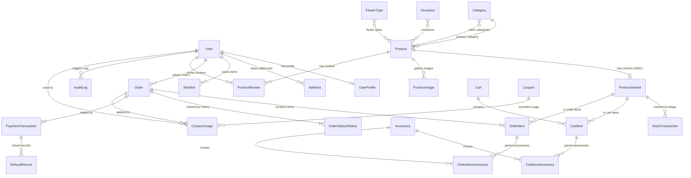

# THIẾT KẾ CƠ SỞ DỮ LIỆU & QUAN HỆ THỰC THỂ (DATABASE SCHEMA & ERD)

Dự án **FLORA FLOWER** sử dụng hệ quản trị cơ sở dữ liệu quan hệ (SQLite cho môi trường phát triển cục bộ và sẵn sàng kết nối PostgreSQL trên Production) thông qua thư viện ORM **Flask-SQLAlchemy**. Toàn bộ cấu trúc bảng được thiết kế đạt chuẩn chuẩn hóa **3NF (Third Normal Form)**, bảo đảm tính toàn vẹn tham chiếu, ràng buộc khóa ngoại chặt chẽ và không phát sinh dị thường khi cập nhật.

---

## 1. Sơ Đồ Thực Thể Quan Hệ Tổng Thể (Mermaid ERD)

---

## 2. Chi Tiết Các Bảng Dữ Liệu & Mô Hình ORM (Flask-SQLAlchemy)

### 2.1. Phân Hệ Người Dùng & Hồ Sơ (`app/models/user.py`)

#### Bảng `auth_user` (Tài khoản người dùng)
- `id`: `Integer`, Primary Key, Autoincrement.
- `username`: `String(150)`, Unique, Not Null — Tên đăng nhập.
- `email`: `String(254)`, Unique, Not Null — Địa chỉ email nhận thông báo.
- `password`: `String(128)`, Not Null — Mật khẩu băm (Werkzeug pbkdf2 / sha256).
- `first_name`, `last_name`: `String(150)` — Họ và tên người dùng.
- `is_active`: `Boolean`, Default: `True` — Kích hoạt tài khoản.
- `is_staff`: `Boolean`, Default: `False` — Quyền truy cập trang quản trị.
- `is_superuser`: `Boolean`, Default: `False` — Quyền quản trị tối cao.
- `date_joined`: `DateTime`, Default: `utcnow`.

#### Bảng `accounts_userprofile` (Mở rộng vai trò & bảo mật)
- `id`: `Integer`, Primary Key.
- `user_id`: `Integer`, ForeignKey(`auth_user.id`, ondelete='CASCADE'), Unique.
- `role`: `String(20)`, Default: `'CUSTOMER'` — Vai trò: `CUSTOMER`, `STAFF`, `ADMIN`.
- `phone`: `String(20)` — Số điện thoại liên hệ.
- `avatar`: `String(200)` — Đường dẫn ảnh đại diện.
- `is_locked`: `Boolean`, Default: `False` — Cờ khóa tài khoản vi phạm.
- `created_at`, `updated_at`: `DateTime`.

#### Bảng `accounts_address` (Sổ địa chỉ người nhận thân quen)
- `id`: `Integer`, Primary Key.
- `user_id`: `Integer`, ForeignKey(`auth_user.id`, ondelete='CASCADE').
- `recipient_name`: `String(100)` — Tên người nhận mặc định.
- `phone`: `String(20)` — Số điện thoại người nhận.
- `address_line`: `String(255)` — Số nhà, tên đường.
- `ward`: `String(100)` — Phường/Xã.
- `district`: `String(100)` — Quận/Huyện.
- `city`: `String(100)`, Default: `'TP. Hồ Chí Minh'`.
- `is_default`: `Boolean`, Default: `False`.

#### Bảng `accounts_wishlist` (Sản phẩm hoa yêu thích)
- `id`: `Integer`, Primary Key.
- `user_id`: `Integer`, ForeignKey(`auth_user.id`, ondelete='CASCADE').
- `product_id`: `Integer`, ForeignKey(`catalog_product.id`, ondelete='CASCADE').
- Ràng buộc: `UniqueConstraint('user_id', 'product_id')`.

---

### 2.2. Phân Hệ Danh Mục & Sản Phẩm Hoa (`app/models/catalog.py`)

#### Bảng `catalog_category` (Kiểu dáng cắm hoa)
- `id`: `Integer`, Primary Key.
- `name`: `String(100)`, Not Null — Tên kiểu dáng (Bó hoa, Giỏ hoa, Hộp hoa, Bình hoa, Kệ hoa).
- `slug`: `String(120)`, Unique, Not Null — URL thân thiện SEO.
- `description`: `Text` — Mô tả chi tiết.
- `image`: `String(200)` — Đường dẫn ảnh đại diện danh mục.
- `icon`: `String(50)` — Icon Bootstrap (bi-flower1, bi-basket...).
- `display_order`: `Integer`, Default: `0`.
- `is_active`: `Boolean`, Default: `True`.

#### Bảng `catalog_occasion` (Dịp tặng hoa)
- `id`: `Integer`, Primary Key.
- `name`: `String(100)`, Not Null — Sinh nhật, Khai trương, Tình yêu, Cưới hỏi, Chia buồn...
- `slug`: `String(120)`, Unique, Not Null.
- `description`: `Text`.
- `image`: `String(200)`.
- `is_active`: `Boolean`, Default: `True`.

#### Bảng `catalog_flowertype` (Loài hoa chủ đạo)
- `id`: `Integer`, Primary Key.
- `name`: `String(100)`, Not Null — Hoa hồng, Hoa baby, Hướng dương, Cẩm tú cầu, Lan hồ điệp...
- `slug`: `String(120)`, Unique, Not Null.

#### Bảng `catalog_product` (Mẫu hoa tươi)
- `id`: `Integer`, Primary Key.
- `name`: `String(200)`, Not Null — Tên thương mại của thiết kế hoa.
- `slug`: `String(220)`, Unique, Not Null.
- `sku`: `String(50)`, Unique, Not Null — Mã định danh duy nhất (Index).
- `category_id`: `Integer`, ForeignKey(`catalog_category.id`, ondelete='SET NULL').
- `short_description`: `String(500)`.
- `description`: `Text` — Mô tả chi tiết ý nghĩa và thành phần hoa.
- `care_instructions`: `Text` — Hướng dẫn chăm sóc hoa tươi lâu.
- `main_image`: `String(200)` — Ảnh đại diện chính thức.
- `status`: `String(20)`, Default: `'PUBLISHED'` — Choices: `DRAFT`, `PUBLISHED`, `ARCHIVED`.
- `is_featured`: `Boolean`, Default: `False` — Hiển thị nổi bật trang chủ.
- `is_bestseller`: `Boolean`, Default: `False`.
- `created_at`, `updated_at`: `DateTime`.

#### Bảng `catalog_productvariant` (Biến thể kích thước Size S/M/L)
- `id`: `Integer`, Primary Key.
- `product_id`: `Integer`, ForeignKey(`catalog_product.id`, ondelete='CASCADE'), Not Null.
- `name`: `String(100)`, Not Null — Tiêu chuẩn (Size S), Vừa vặn (Size M), Đặc biệt (Size L).
- `sku`: `String(60)`, Unique, Not Null — SKU riêng của biến thể.
- `price`: `Numeric(12, 2)`, Not Null — Giá niêm yết gốc.
- `sale_price`: `Numeric(12, 2)`, Nullable — Giá khuyến mãi giảm (nếu có).
- `stock`: `Integer`, Default: `0`, Not Null — Số lượng hoa đang có sẵn trong kho.
- `stem_count_estimate`: `Integer` — Ước tính số cành hoa được cắm.
- `height_cm`: `Integer` — Chiều cao ước tính của bó/giỏ hoa.
- `is_default`: `Boolean`, Default: `False` — Biến thể mặc định hiển thị khi vào xem mẫu.
- `is_active`: `Boolean`, Default: `True`.

#### Bảng `catalog_accessory` (Phụ kiện bán kèm)
- `id`: `Integer`, Primary Key.
- `name`: `String(150)`, Not Null — Thiệp viết tay, Băng rôn chúc mừng, Gấu bông mini...
- `price`: `Numeric(12, 2)`, Not Null — Đơn giá phụ kiện.
- `stock`: `Integer`, Default: `100`.
- `image`: `String(200)`.
- `is_active`: `Boolean`, Default: `True`.

---

### 2.3. Phân Hệ Giỏ Hàng (`app/models/cart.py`)

#### Bảng `cart_cart`
- `id`: `Integer`, Primary Key.
- `user_id`: `Integer`, ForeignKey(`auth_user.id`, ondelete='CASCADE'), Nullable — Gắn với tài khoản (nếu đã đăng nhập).
- `session_key`: `String(40)`, Nullable, Index — Gắn với Session Cookie (nếu khách vãng lai).
- `coupon_id`: `Integer`, ForeignKey(`promotions_coupon.id`, ondelete='SET NULL'), Nullable.
- `created_at`, `updated_at`: `DateTime`.

#### Bảng `cart_cartitem`
- `id`: `Integer`, Primary Key.
- `cart_id`: `Integer`, ForeignKey(`cart_cart.id`, ondelete='CASCADE'), Not Null.
- `variant_id`: `Integer`, ForeignKey(`catalog_productvariant.id`, ondelete='CASCADE'), Not Null.
- `quantity`: `Integer`, Default: `1`, Not Null.
- `card_message`: `Text` — Lời chúc in trên thiệp của từng món hoa.
- `card_sender_name`: `String(100)` — Tên người gửi trên thiệp.
- `is_anonymous`: `Boolean`, Default: `False` — Tùy chọn ẩn danh người gửi.

#### Bảng `cart_cartitemaccessory`
- `id`: `Integer`, Primary Key.
- `cart_item_id`: `Integer`, ForeignKey(`cart_cartitem.id`, ondelete='CASCADE'), Not Null.
- `accessory_id`: `Integer`, ForeignKey(`catalog_accessory.id`, ondelete='CASCADE'), Not Null.
- `quantity`: `Integer`, Default: `1`, Not Null.

---

### 2.4. Phân Hệ Đơn Hàng Hoa Tươi (`app/models/order.py`)

#### Bảng `orders_order`
- `id`: `Integer`, Primary Key.
- `order_number`: `String(32)`, Unique, Not Null — Mã đơn (e.g. `FL-20261028-1A2B`).
- `user_id`: `Integer`, ForeignKey(`auth_user.id`, ondelete='SET NULL'), Nullable.
- **Thông tin người đặt (Sender):**
  - `sender_name`: `String(100)`, Not Null.
  - `sender_phone`: `String(20)`, Not Null.
  - `sender_email`: `String(254)`, Not Null — Nơi nhận hóa đơn và email Flask-Mail.
- **Thông tin người nhận (Recipient):**
  - `recipient_name`: `String(100)`, Not Null.
  - `recipient_phone`: `String(20)`, Not Null.
  - `recipient_address`: `String(255)`, Not Null.
  - `recipient_ward`, `recipient_district`, `recipient_city`: `String(100)`.
- **Thông số lịch giao hoa & Quà tặng:**
  - `delivery_date`: `Date`, Not Null — Ngày khách yêu cầu giao.
  - `delivery_time_slot`: `String(30)`, Not Null — Khung giờ Sáng/Trưa/Chiều/Tối.
  - `card_message`: `Text` — Lời nhắn trên thiệp.
  - `is_anonymous`: `Boolean`, Default: `False` — Gửi hoa giấu tên.
  - `special_notes`: `Text` — Ghi chú giao hàng (gọi trước, để quầy lễ tân...).
  - `florist_notes`: `Text` — Ghi chú riêng cho thợ cắm hoa.
- **Trạng thái & Tài chính:**
  - `status`: `String(20)`, Default: `'PENDING'` — `PENDING`, `CONFIRMED`, `PREPARING`, `READY`, `DELIVERING`, `COMPLETED`, `CANCELLED`.
  - `payment_method`: `String(20)`, Default: `'COD'` — `COD`, `VIETQR`.
  - `payment_status`: `String(20)`, Default: `'UNPAID'` — `UNPAID`, `WAITING_VERIFICATION`, `PAID`, `REFUNDED`.
  - `flowers_subtotal`: `Numeric(12, 2)`, Not Null — Tiền hoa tươi.
  - `accessories_subtotal`: `Numeric(12, 2)`, Default: `0`.
  - `shipping_fee`: `Numeric(12, 2)`, Default: `0`.
  - `discount_amount`: `Numeric(12, 2)`, Default: `0`.
  - `total_amount`: `Numeric(12, 2)`, Not Null — Tổng thanh toán cuối cùng.
  - `created_at`, `updated_at`: `DateTime`.

#### Bảng `orders_orderitem` (Áp dụng Snapshot Pattern)
- `id`: `Integer`, Primary Key.
- `order_id`: `Integer`, ForeignKey(`orders_order.id`, ondelete='CASCADE'), Not Null.
- `product_variant_id`: `Integer`, ForeignKey(`catalog_productvariant.id`, ondelete='SET NULL'), Nullable.
- `product_name`: `String(200)`, Not Null — Snapshot tên hoa tại thời điểm mua.
- `variant_name`: `String(100)`, Not Null — Snapshot tên kích thước.
- `sku`: `String(60)`, Not Null.
- `unit_price`: `Numeric(12, 2)`, Not Null — Snapshot giá bán tại thời điểm đặt đơn.
- `quantity`: `Integer`, Not Null.
- `subtotal`: `Numeric(12, 2)`, Not Null.
- `card_message`: `Text`.
- `is_anonymous`: `Boolean`, Default: `False`.

---

### 2.5. Phân Hệ Kho & Sổ Cái Giao Dịch (`app/models/inventory.py`)

#### Bảng `inventory_stocktransaction` (Stock Ledger)
- `id`: `Integer`, Primary Key.
- `variant_id`: `Integer`, ForeignKey(`catalog_productvariant.id`, ondelete='CASCADE'), Not Null.
- `transaction_type`: `String(20)`, Not Null — `SALE`, `CANCEL_RESTORE`, `IMPORT`, `ADJUST`.
- `quantity_change`: `Integer`, Not Null — Biến động số lượng (+/-).
- `balance_after`: `Integer`, Not Null — Tồn kho sau giao dịch.
- `reason`: `String(255)` — Lý do (Số hóa đơn, Đợt nhập hàng, Hao hụt...).
- `performed_by_id`: `Integer`, ForeignKey(`auth_user.id`, ondelete='SET NULL'), Nullable.
- `reference_order_id`: `Integer`, ForeignKey(`orders_order.id`, ondelete='SET NULL'), Nullable.
- `created_at`: `DateTime`, Default: `utcnow`.

---

### 2.6. Phân Hệ Thanh Toán & VietQR (`app/models/payment.py`)

#### Bảng `payments_paymenttransaction`
- `id`: `Integer`, Primary Key.
- `order_id`: `Integer`, ForeignKey(`orders_order.id`, ondelete='CASCADE'), Not Null.
- `transaction_code`: `String(64)`, Unique, Not Null — Mã giao dịch ngân hàng / VietQR.
- `payment_method`: `String(20)`, Not Null — `VIETQR`, `COD`.
- `amount`: `Numeric(12, 2)`, Not Null.
- `status`: `String(20)`, Default: `'PENDING'` — `PENDING`, `WAITING_VERIFICATION`, `PAID`, `FAILED`, `CANCELLED`.
- `payment_proof_image`: `String(200)`, Nullable — Ảnh chụp biên lai ủy nhiệm chi do khách upload.
- `created_at`, `updated_at`: `DateTime`.

---

### 2.7. Phân Hệ Khuyến Mãi & Voucher (`app/models/promotion.py`)

#### Bảng `promotions_coupon`
- `id`: `Integer`, Primary Key.
- `code`: `String(50)`, Unique, Not Null (e.g. `FLORA10`).
- `title`: `String(200)`, Not Null.
- `discount_type`: `String(20)`, Not Null — `PERCENT` hoặc `FIXED`.
- `discount_value`: `Numeric(12, 2)`, Not Null.
- `min_order_amount`: `Numeric(12, 2)`, Default: `0`.
- `max_discount_amount`: `Numeric(12, 2)`, Nullable.
- `valid_from`, `valid_to`: `DateTime`.
- `usage_limit`: `Integer`, Default: `100`.
- `times_used`: `Integer`, Default: `0`.
- `is_active`: `Boolean`, Default: `True`.

---

### 2.8. Phân Hệ Đánh Giá & Kiểm Duyệt (`app/models/review.py`)

#### Bảng `reviews_productreview`
- `id`: `Integer`, Primary Key.
- `product_id`: `Integer`, ForeignKey(`catalog_product.id`, ondelete='CASCADE'), Not Null.
- `user_id`: `Integer`, ForeignKey(`auth_user.id`, ondelete='CASCADE'), Not Null.
- `order_id`: `Integer`, ForeignKey(`orders_order.id`, ondelete='CASCADE'), Not Null.
- `rating`: `Integer`, Not Null — Đánh giá từ 1 đến 5 sao.
- `comment`: `Text`, Not Null.
- `is_verified_purchase`: `Boolean`, Default: `True` — Xác nhận chỉ khách đã nhận hoa thành công mới được đánh giá.
- `status`: `String(20)`, Default: `'APPROVED'` — `PENDING`, `APPROVED`, `HIDDEN`.
- `admin_response`: `Text`, Nullable — Phản hồi của cửa hàng.
- `created_at`: `DateTime`.

---

### 2.9. Phân Hệ Cài Đặt & Nhật Ký Kiểm Toán (`app/models/core.py`)

#### Bảng `core_shopsetting` (Singleton Pattern)
- `id`: `Integer`, Primary Key.
- `shop_name`: `String(150)`, Default: `'FLORA FLOWER'`.
- `slogan`: `String(255)`.
- `phone`, `hotline`, `email`, `address`: `String(150)`.
- `bank_code`, `bank_name`, `bank_account_no`, `bank_account_name`: Thông tin tài khoản nhận chuyển khoản VietQR.
- `shipping_fee_default`: `Numeric(12, 2)`, Default: `30000`.
- `free_shipping_threshold`: `Numeric(12, 2)`, Default: `500000`.
- `min_prep_hours`: `Integer`, Default: `2`.
- `same_day_cutoff_hour`: `Integer`, Default: `19`.
- `max_orders_per_slot`: `Integer`, Default: `15`.

#### Bảng `core_auditlog` (Nhật ký truy vết thao tác quản trị)
- `id`: `Integer`, Primary Key.
- `user_id`: `Integer`, ForeignKey(`auth_user.id`, ondelete='SET NULL'), Nullable.
- `action`: `String(30)` — `CREATE`, `UPDATE`, `DELETE`, `SOFT_DELETE`, `STATUS_CHANGE`, `PAYMENT_CONFIRM`.
- `model_name`: `String(100)` — `Product`, `Order`, `PaymentTransaction`...
- `object_id`: `String(100)`.
- `object_repr`: `String(255)`.
- `details`: `Text`.
- `created_at`: `DateTime`, Default: `utcnow`.
